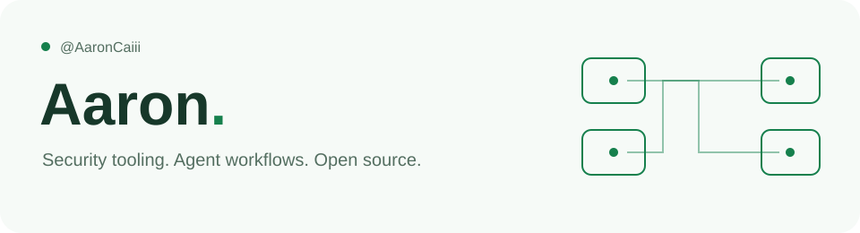

  <picture>
    <source media="(prefers-color-scheme: dark)" srcset="assets/profile-dark.svg">
    <source media="(prefers-color-scheme: light)" srcset="assets/profile-light.svg">
    
  </picture>

  <a href="https://github.com/AaronCaiii/AgenticPentest">AgenticPenTest</a> ·
  <a href="https://github.com/AaronCaiii/Notes">Security notes</a> ·
  <a href="https://github.com/sponsors/AaronCaiii">Sponsor</a> ·
  <a href="mailto:wchensmile@gmail.com">Contact</a>

<strong>OSCP</strong> &nbsp; | &nbsp; macOS <strong>27.0</strong> &nbsp; | &nbsp; <strong>Windows 11</strong>

I build security tools and turn research into repeatable workflows. Currently developing **[AgenticPenTest](https://github.com/AaronCaiii/AgenticPentest)**, an open-source workbench connecting assets, threat modeling, Agent tasks, and evidence reports.

专注安全工具、Agent 工作流与知识整理。正在开发 **AgenticPenTest**，让资产、威胁建模、测试任务与证据报告形成完整流程。

### 🛠️ Selected work

| Project | What you'll find |
| --- | --- |
| **[AgenticPenTest](https://github.com/AaronCaiii/AgenticPentest)** | Agent-powered security testing: asset mapping, STRIDE threat modeling, cloud assessment, evidence reports, and developer MCP access. |
| **[Security Notes](https://github.com/AaronCaiii/Notes)** | OSCP study notes and target notes, with Chinese and English material. |
| **[Proving Grounds Practice](https://github.com/AaronCaiii/OSCP-Prepare-Proving-grounds-Practice)** | Practice notes and write-ups from the OSCP preparation journey. |

### 🤝 Connect & support

[Email](mailto:wchensmile@gmail.com) · [GitHub Sponsors](https://github.com/sponsors/AaronCaiii) · [爱发电](https://ifdian.net/a/aaronovo)

I share security research and project updates on **Aaron与安全的那些事**. 欢迎交流、提交 Issue、贡献代码，或赞助项目的持续开发。

  

